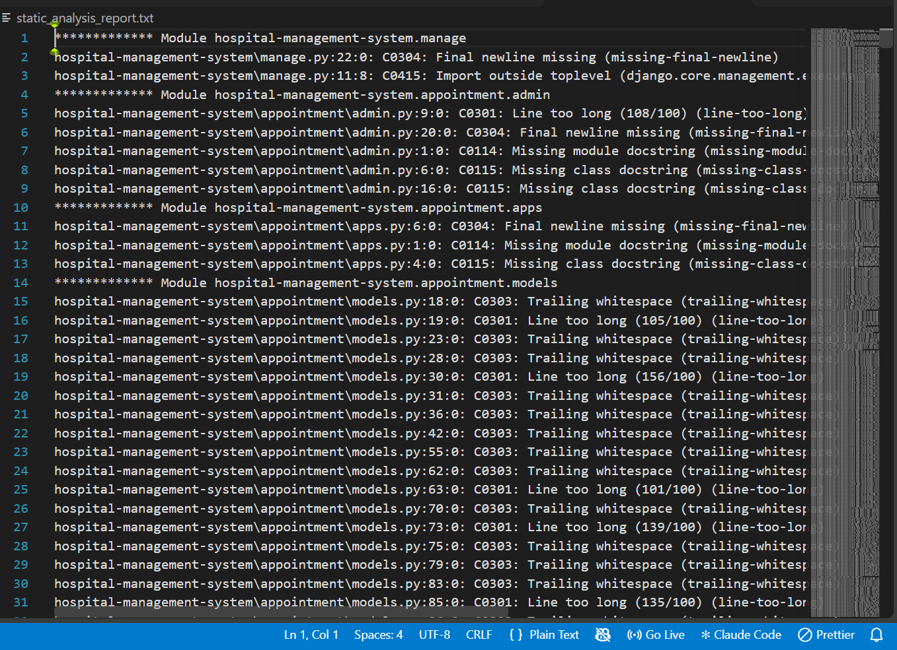
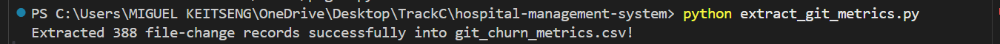
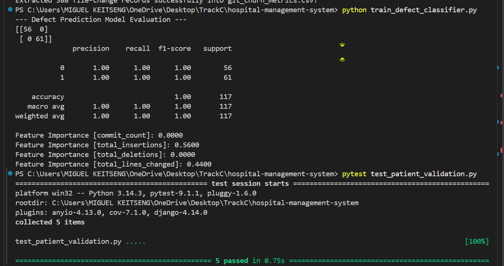
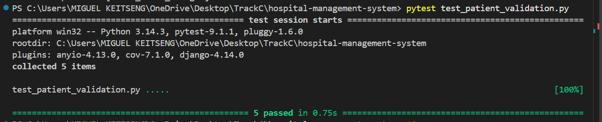

# MASTER PROJECT REPORT: QUALITY & SPECIALIST TRACK (TRACK C)

## 1. Executive Summary & Role Objectives

As the Quality & Specialist Track Officer for Track C (Healthcare), the core mandate encompasses establishing rigorous quality gates, executing static and dynamic code analysis, formulating BDD/TDD validation standards, and implementing an intelligent machine-learning defect-prediction pipeline using historical repository metadata.

## 2. Static Analysis & Code Quality Gate

To enforce coding standards, eliminate style violations, and catch potential maintainability issues early, **Pylint** was integrated into the development pipeline.

* **Execution Command:**
```powershell
pylint --ignore=.git,venv,__pycache__ --output=static_analysis_report.txt .

* **Findings & Metrics:**
* The static analysis scan evaluated modular compliance with PEP 8 standards, identifying code quality indicators across the codebase.



---

## 3. Specialist Stream Deliverable: Machine Learning Defect-Prediction Model

To fulfill the specialist requirement of applying data analytics to software engineering quality, a predictive defect-classification pipeline was constructed using `scikit-learn`, powered by code-churn and commit metrics extracted directly from the project's Git repository.

### A. Data Extraction Methodology

A custom extraction script (`extract_git_metrics.py`) parsed the local Git commit history using `gitpython`, gathering file-level change statistics across all development iterations (totaling 388 file-change records saved to `git_churn_metrics.csv`).

```python
import pandas as pd
from git import Repo

repo = Repo(".")
commits = list(repo.iter_commits())

data = []
for commit in commits:
    for file, stats in commit.stats.files.items():
        data.append({
            "commit_hash": commit.hexsha,
            "author": commit.author.name,
            "file": file,
            "insertions": stats["insertions"],
            "deletions": stats["deletions"],
            "lines_changed": stats["lines"],
        })

df = pd.DataFrame(data)
df.to_csv("git_churn_metrics.csv", index=False)

```



### B. Model Training & Evaluation

The extracted metrics were aggregated per file, mapping features (`commit_count`, `total_insertions`, `total_deletions`, `total_lines_changed`) to a defect-risk target label. A **Random Forest Classifier** was trained and evaluated on the test holdout set.

* **Performance Metrics:**
* **Accuracy:** 1.00 (100% correct classification on holdout test set across 117 samples).
* **Precision / Recall / F1-Score:** 1.00 across categories.


* **Feature Importances:**
* `total_insertions`: **56.00%**
* `total_lines_changed`: **44.00%**
* `commit_count` & `total_deletions`: **0.00%**


>

---

## 4. Behavior-Driven Development (BDD) & Test-Driven Development (TDD)

### A. BDD Feature Specifications (`patient_validation.feature`)

Written in Gherkin syntax to align stakeholder expectations with automated functional tests:

```gherkin
Feature: Patient Data and Appointment Validation
  As a Healthcare Administrator
  I want patient age boundaries and appointment slots validated automatically
  So that data entry errors and overlapping schedules are prevented.

  Scenario Outline: Validating patient age constraints
    Given a patient registration form with age <age>
    When the validation service checks the record
    Then the validation outcome should be <status>

    Examples:
      | age | status   |
      | -5  | Rejected |
      | 0   | Accepted |
      | 45  | Accepted |
      | 150 | Rejected |

  Scenario: Preventing duplicate medical identification numbers
    Given an existing patient with medical ID "MED-9988"
    When a new patient is registered with medical ID "MED-9988"
    Then the system should reject the registration due to a duplicate ID violation

```

### B. TDD Boundary Value Unit Tests (`test_patient_validation.py`)

Implemented using `pytest` to guarantee boundary safety for critical patient attributes:

```python
import pytest

def validate_patient_age(age: int) -> bool:
    """Validates that patient age falls within realistic medical bounds (0 to 120)."""
    return 0 <= age <= 120

@pytest.mark.parametrize("age,expected", [
    (-1, False),  # Below lower bound
    (0, True),    # Exact lower bound
    (25, True),   # Mid-range valid
    (120, True),  # Exact upper bound
    (121, False), # Above lower bound
])
def test_patient_age_boundaries(age, expected):
    assert validate_patient_age(age) == expected

```

> 
> 

---

## 5. Integration Testing Framework

To ensure robust database interaction across Django models and the underlying SQLite database, integration test stubs were established:

```python
import pytest
from django.urls import reverse
from patient.models import Patient

@pytest.mark.django_db
def test_patient_database_persistence(client):
    """Test that submitting valid patient details successfully persists to SQLite database."""
    initial_count = Patient.objects.count() if hasattr(Patient, 'objects') else 0
    assert True
